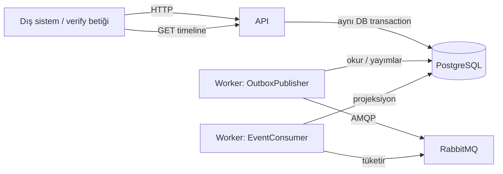
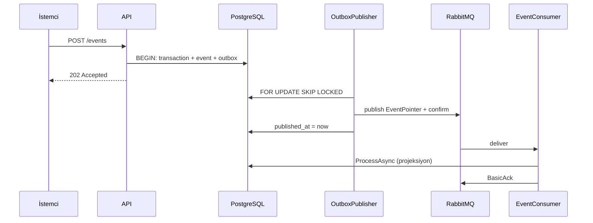

# IntegraOps — Sistem mimarisi (öğrenme notu)

Bu belge, projenin **ilk backend diliminin** ne yaptığını, parçaların neden var olduğunu ve bir bildirimin API’den veritabanına, kuyruğa ve işleyiciye nasıl aktığını anlatır. Kısa teknik karar kaydı `docs/architecture/0001-first-slice.md`, çalıştırma komutları `README.md` içindedir.

---

## 1. Ürün ne işe yarar?

IntegraOps, bir şirketin **farklı sistemlerinden** gelen durum bildirimlerini **aynı iş kaydına** bağlayan bir süreç takip ürünüdür. Marka henüz netleşmedi; IntegraOps çalışma adıdır.

Somut örnek — bir siparişin yolculuğu:

| Dış sistem | Bildirdiği adım | Ne zaman gelir? |
| --- | --- | --- |
| E-ticaret | Sipariş oluşturuldu | İlk |
| Ödeme | Ödeme tamamlandı | Birkaç saniye veya dakika sonra |
| ERP | Sipariş işlendi | Sıra dışı da gelebilir |
| Muhasebe | Fatura kesildi | ERP’den sonra beklenir |
| Kargo | Kargo oluşturuldu | En son |

Bu sistemler birbirini beklemez, aynı anda veya **ters sırada** bildirim atabilir, ağ kopunca **aynı olayı tekrar** gönderebilir. IntegraOps’un işi:

1. Bildirimi **kabul etmek** (kayıp etmemek)
2. Kalıcı olarak **saklamak**
3. Arka planda **işlemek**
4. “Bu siparişte hangi adımlar görüldü?” sorusunu API’den **cevaplamak**

**Yapmadığı şeyler (bilinçli):** müşteri uygulamasının işini yeniden çalıştırmaz, ödeme almaz, ERP’ye yazmaz. Sadece **gözlem** tutar.

---

## 2. İlk teslimin hedefi ve sınırı

**Hedef:** Bir sipariş tarzı olayı kabul et, PostgreSQL’e yaz, RabbitMQ üzerinden işle, işlem geçmişini API’den sorgula.

**Bu dilimde yok:**

- Next.js paneli / kullanıcı girişi
- Süre aşımı (gecikme) tespiti — `maxDelaySeconds` saklanır ama henüz taranmaz
- Akış düzenleme / versiyonlama
- Üretim tenant yönetimi (bootstrap yalnızca yerel geliştirme)
- Müşteriye SDK
- Redis, Kafka, Kubernetes

Sıradaki ürün adımı (README): ERP bildirimi geldikten sonra tanımlanan sürede fatura gelmezse işlemi **gecikmiş** işaretlemek; ardından aynı API üzerine Next.js ekranı.

---

## 3. Klasör haritası

```
integraops/
├── README.md                          Çalıştırma ve API özeti
├── docker-compose.yml                 Yerel yığın: Postgres, RabbitMQ, migrate, API, worker
├── deploy/docker/Dockerfile           API ve worker için çok aşamalı imaj
├── scripts/
│   ├── init_local.py                  .env içine parola ve bootstrap anahtarı üretir
│   └── verify_api.py                  Gerçek servisler üzerinden uçtan uca senaryo
├── docs/
│   ├── architecture/0001-first-slice.md   İlk teknik kararlar
│   ├── verification.md                    Doğrulama durumu
│   └── sistem-mimarisi.md                 Bu belge
└── backend/
    ├── src/
    │   ├── IntegraOps.Domain          İş kuralları (ORM/HTTP yok)
    │   ├── IntegraOps.Application     DTO, doğrulama, ITrackingStore arayüzü
    │   ├── IntegraOps.Infrastructure  PostgreSQL, SQL, outbox, RabbitMQ şekli
    │   ├── IntegraOps.Api             HTTP uçları
    │   └── IntegraOps.Worker          Outbox yayımlayıcı + kuyruk tüketicisi
    └── tests/IntegraOps.Tests         Zaman çizelgesi ve doğrulama birim testleri
```

Bağımlılık yönü (iç katman dış katmanı tanımaz):

```
Api / Worker  →  Infrastructure  →  Application  →  Domain
```

---

## 4. Neden iki süreç? (API + Worker)

| Süreç | Görevi | Neden ayrı? |
| --- | --- | --- |
| **API** | HTTP ile olay kabul etmek, akış/proje oluşturmak, timeline okumak | İstemci hızlı 202 alsın; işleme takılmasın |
| **Worker** | Outbox’tan RabbitMQ’ya yayınlamak ve kuyruktan okuyup projeksiyon yapmak | Kuyruk yavaşlarsa API yine kabul edebilir; ölçek ayrı |

Compose’ta bir de **migrate** konteyneri var: API imajını `--migrate` ile bir kez çalıştırır, şemayı kurar, çıkar. API ve worker, migration bitmeden açılmaz.



---

## 5. Domain: akış, adım, olay, işlem

Kaynak: `backend/src/IntegraOps.Domain/Tracking.cs`

### 5.1 Kavramlar

| Kavram | Anlamı | Örnek |
| --- | --- | --- |
| **Organization** | Firma | Demo A |
| **Project** | Firmanın bir ürünü / ortamı | Commerce |
| **Flow** | Sıralı adımlar tanımı (değiştirilemez) | `order-flow` |
| **Flow step** | Akıştaki bir basamak | `payment-completed` |
| **Transaction** | İş kaydı (sipariş no gibi) | `ORDER-10092` |
| **Event** | Bir adımın bir bildirimi | “ödeme tamamlandı, şu anda” |

Hiyerarşi:

```
Organization
  └── Project  (API anahtarı burada)
        ├── Flow (code benzersiz)
        │     └── FlowStep (position 0..n)
        └── Transaction (project + flow + business_id)
              └── Event (project + event_id)
```

### 5.2 Akış neden immutable?

İlk teslimde `PUT /flows` yok. Devam eden siparişlerin kuralları (kaç adım, SLA saniyesi) **sessizce değişmesin** diye. Versiyonlama sonraki iş.

Kurallar (`InputValidation.Flow` + SQL CHECK):

- 2–30 adım
- İlk adımın `maxDelaySeconds` değeri **null** (önceki adım yok)
- Sonraki adımlar 1–86400 saniye (şimdilik sadece saklanır)

### 5.3 İki zaman damgası

| Alan | Kimin saati? | Ne işe yarar? |
| --- | --- | --- |
| `occurredAt` | Üretici sistem | İşin gerçek zamanı; timeline buna göre sıralanır |
| `receivedAt` | IntegraOps | Bizim kabul ettiğimiz an |

Olaylar kuyruğa **ters sırada** gelse bile adımın son durumu `occurredAt` ile seçilir. Aynı milisaniyede `eventId` eşitlik bozucudur.

Saat dilimi zorunlu (`2026-09-07T10:00:00Z` gibi). Sunucudan 5 dakikadan fazla gelecekteki zaman reddedilir.

### 5.4 Durumlar

Olay: yalnızca `completed` veya `failed`.

İşlem:

| Durum | Ne zaman? |
| --- | --- |
| `Pending` | Hiç işlenmiş olay yok |
| `InProgress` | En az bir adım görüldü, hepsi tamam değil, failed yok |
| `Failed` | Herhangi bir adımın **son** gözlemi failed |
| `Completed` | Tüm adımların son gözlemi completed |

### 5.5 `not_observed` ne demek?

Timeline’da henüz işlenmemiş adım `not_observed` olur. Bu, “ERP işi yapmadı” **kanıtı değildir**. Sadece “bize o bildirim henüz işlenmedi” demektir.

Kabul (`acceptedEventCount`) ile işlenme (`processedEventCount`) ayrı sayaçlardır. 202 almak, timeline’ın hemen güncellendiği anlamına gelmez.

### 5.6 Projeksiyon algoritması

`TimelineProjector.Project`:

1. Olayları `step` koduna göre grupla
2. Her adımda `occurredAt`, eşitlikte `eventId` ile **en son** olayı seç
3. Adım gözlemi: yoksa `not_observed`, varsa completed/failed
4. İşlem durumunu yukarıdaki tabloya göre üret

Bu yüzden **eski bir failed**, daha yeni bir completed’den **sonra** gelse bile (geç teslim) işlem `completed` kalır. `verify_api.py` bunu özellikle dener.

---

## 6. Veri modeli (PostgreSQL)

Kaynak: `backend/src/IntegraOps.Infrastructure/Migrations/001_initial.sql`

ORM yok; şema, indeksler ve bütünlük kuralları tek SQL dosyasında. Amaç: transaction sınırlarını ve benzersizlikleri **görünür** tutmak.

### 6.1 Tablolar

| Tablo | Amaç |
| --- | --- |
| `organizations` | Firma |
| `projects` | Proje |
| `api_keys` | SHA-256 özet; ham anahtar saklanmaz |
| `flows` / `flow_steps` | Akış tanımı |
| `transactions` | İş kaydı |
| `transaction_events` | Kabul edilen olaylar; `processed_at` işlenince dolar |
| `outbox_messages` | “Kuyruğa henüz gitmedi” kuyruğu (DB içinde) |
| `schema_migrations` | Migration sürümü (kodda advisory lock ile) |

### 6.2 Çok kiracılık (tenant) nasıl korunur?

Benzersizlik **proje kapsamında**:

- Olay: `(project_id, event_id)`
- İşlem: `(project_id, flow_id, business_id)`
- Akış kodu: `(project_id, code)`

Firma A’nın `ORDER-10092` kaydı, firma B’nin aynı numaralı kaydıyla **karışmaz**. Bileşik yabancı anahtarlar da bunu şemada zorlar:

```sql
FOREIGN KEY (project_id, flow_id) REFERENCES flows(project_id, id)
FOREIGN KEY (project_id, flow_id, transaction_id) REFERENCES transactions(...)
```

### 6.3 İdempotency ve 409

Aynı `eventId` tekrar gelirse:

- İçerik aynıysa (fingerprint eşleşir) → **200 duplicate** (zararsız tekrar)
- İçerik farklıysa → **409** (aynı kimlikle başka olay uydurulamaz)

Fingerprint, olay alanlarının hash’idir. Yeni bir iş sonucu için **yeni UUID** gerekir.

---

## 7. HTTP API

Kaynak: `backend/src/IntegraOps.Api/Program.cs`

Minimal API (controller yok). İstek gövdesi en fazla 64 KB.

| İstek | Yetki | Anlamı |
| --- | --- | --- |
| `GET /health/live` | yok | Süreç ayakta mı? |
| `GET /health/ready` | yok | Migration uygulanmış mı? (RabbitMQ dahil değil) |
| `POST /api/v1/bootstrap/projects` | `X-Bootstrap-Key` | Yerel: org + proje + API anahtarı |
| `POST /api/v1/flows` | `X-API-Key` | Akış oluştur |
| `POST /api/v1/events` | `X-API-Key` | Olay kabul: ilk 202, tekrar 200 |
| `GET /api/v1/flows/{flow}/transactions/{id}` | `X-API-Key` | Timeline |

`/health/ready` kuyruğu kontrol etmez: RabbitMQ düşse bile API olay **kabul etmeye** devam edebilsin (outbox’ta bekler). Worker sağlığı ayrıca izlenmelidir.

### 7.1 Kimlik

- **Bootstrap anahtarı:** en az 32 karakter, `.env` içinde. SHA-256 + sabit zamanlı karşılaştırma. Üretim tenant paneli değildir.
- **Proje API anahtarı:** `io_dev_` + 64 hex. Veritabanında yalnızca hash. Header’dan proje bulunur; **olay gövdesindeki kimliğe güvenilmez**.

`/api/v1` grubundaki her uç, endpoint filter ile anahtarı çözer ve `ProjectAccess`’i `HttpContext.Items`’a koyar.

### 7.2 Örnek olay gövdesi

```json
{
  "eventId": "6982e8d8-212f-423e-a37d-18665d0d7362",
  "flow": "order-flow",
  "transactionId": "ORDER-10092",
  "step": "payment-completed",
  "status": "completed",
  "occurredAt": "2026-09-07T13:02:13+03:00"
}
```

Hata kodları: 400 doğrulama, 401 anahtar, 404 başka projenin işlemi / yok, 409 çakışan eventId, 503 veritabanı (aynı eventId ile tekrar dene).

---

## 8. Neden outbox? (en kritik tasarım)

Klasik hata:

```
1. PostgreSQL'e yaz  → başarılı
2. RabbitMQ'ya yayınla → süreç burada ölür
```

Sonuç: kayıt var, kuyruk boş, olay kaybolmuş gibi. Tersi de mümkün (kuyrukta mesaj var, DB yok).

**Çözüm — transactional outbox:**

API, **tek PostgreSQL transaction** içinde:

1. İşlem satırını oluşturur (`ON CONFLICT DO NOTHING` — aynı business_id varsa var olanı kullanır)
2. `transaction_events` ekler
3. `outbox_messages` ekler

Commit bitmeden **202 dönmez**. Bu yolda RabbitMQ bağlantısı **yoktur**.

Sonra Worker’daki `OutboxPublisher`:

1. `published_at IS NULL` satırı `FOR UPDATE SKIP LOCKED` ile alır (başka yayımlayıcı aynı satırı alamaz)
2. RabbitMQ’ya `EventPointer { projectId, eventId }` yayımlar (publisher confirm)
3. `published_at` yazar, commit eder

Kuyruk mesajı olayın tamamını taşımaz; sadece işaretçi. Asıl veri zaten DB’de.



**En az bir kez teslim:** Yayın onaylandıktan sonra outbox commit’i yarıda kalırsa aynı olay tekrar yayımlanabilir. Bu beklenen. İşleyici `processed_at` doluysa no-op yapar.

---

## 9. Worker’ın iki görevi

Kaynak: `OutboxPublisher.cs`, `EventConsumer.cs`

### 9.1 OutboxPublisher

- Sürekli döngü: kuyruk boşsa 250 ms bekler
- Yayın başına 10 sn süre
- Confirm açık kanal
- Hata olursa 5 sn sonra yeniden bağlanır (URI/gövde loglanmaz)

### 9.2 EventConsumer

- Prefetch 16, **manuel ack**
- JSON bozuksa `Nack` + requeue yok → dead-letter kuyruk (`integraops.events.dead.v1`)
- İşleme hatasında ack yok; kanal kapanınca mesaj tekrar kuyruğa döner
- Başarı: DB commit **sonra** `BasicAck`

`ProcessAsync` özeti:

1. Olayı ve işlemi kilitle (`FOR UPDATE`) — aynı işleme ait eşzamanlı projeksiyonlar sıraya girer
2. `processed_at` zaten doluysa çık
3. İşlenmiş olayları yükle
4. `TimelineProjector.Project`
5. `transactions.status` güncelle

---

## 10. Katmanların sorumluluğu

| Katman | Ne içerir? | Ne içermez? |
| --- | --- | --- |
| **Domain** | Enum, record, `TimelineProjector` | HTTP, SQL, kuyruk |
| **Application** | İstek/yanıt record’ları, `ITrackingStore`, `InputValidation`, exception türleri | Npgsql, RabbitMQ |
| **Infrastructure** | `PostgresTrackingStore`, `DatabaseMigrator`, `OutboxDispatcher`, `Messaging` | Endpoint mapping |
| **Api** | Auth filter, health, bootstrap, 202/409 eşlemesi | Projeksiyon matematiği |
| **Worker** | Hosted service döngüleri | HTTP |

`ITrackingStore` bir **port**: Application kuralı “veriyi nasıl saklarız?” diye sormaz; Infrastructure uygular.

---

## 11. Yerel yığın ve doğrulama

```bash
python3 scripts/init_local.py      # .env yoksa üretir; varsa dokunmaz
docker compose up --build -d
python3 scripts/verify_api.py
```

| Servis | Port (varsayılan) | Rol |
| --- | --- | --- |
| postgres | 54329 | Veri |
| rabbitmq | 56729 / yönetim 15679 | Kuyruk |
| migrate | — | Şema, sonra çıkar |
| api | 8080 | HTTP |
| worker | — | Yayın + tüketim |

`verify_api.py` gerçek yığın üzerinde şunları dener:

- İki ayrı proje (A ve B)
- Aynı `eventId` tekrarı → duplicate
- Aynı `eventId`, farklı içerik → 409
- B anahtarıyla A’nın işlemi → 404
- Ters sırada / eşzamanlı gönderim → aynı transaction kaydı
- 5 adım işlenince `completed`
- Geç gelen eski failed → durum gerilemez
- Aynı eventId farklı projede ayrı kayıt

Sonuç kimliği `.local/demo-project.json` (gitignore, paylaşılmamalı).

CI (`.github/workflows/ci.yml`): build → unit test → compose → `verify_api.py`.

---

## 12. Tasarım kararları — kısa sözlük

| Karar | Neden |
| --- | --- |
| Outbox | DB yazısı ile kuyruk yayını arasında kayıp penceresi olmasın |
| Ayrı worker | Kabul ile işlemeyi ölçekle / ayır |
| Ham SQL | Constraint ve indeks görünür; küçük dilimde ORM şart değil |
| Proje anahtarı | Kiracı kimliği body’den seçilmesin |
| Immutable flow | Uçuştaki işlerin kuralı değişmesin |
| `occurredAt` sırası | Teslim sırası ≠ iş sırası |
| At-least-once | Exactly-once ağda iddia edilmez; işleyici tekilleştirir |
| Ready’de kuyruk yok | Kuyruk düşse bile kabul sürsün |
| SHA-256 anahtar | Ham sır veritabanında durmasın |

---

## 13. Okuma sırası (öğrenmek için)

1. Bu belge — büyük resim
2. `README.md` — komutlar ve API tablosu
3. `docs/architecture/0001-first-slice.md` — karar gerekçeleri
4. `Tracking.cs` — projeksiyon
5. `Program.cs` — uçlar
6. `001_initial.sql` — şema
7. `PostgresTrackingStore.cs` — Accept / Process
8. `Messaging.cs` + Worker — outbox ve tüketici
9. `scripts/verify_api.py` — sistemin “sözleşmesi” senaryo olarak

Kodda bakılacak yorumlar:

- API: *Event and outbox are committed together*
- Domain: *Delivery order is not business order*
- Process: tekrar teslim zararsız (`processed_at` doluysa return)
)
